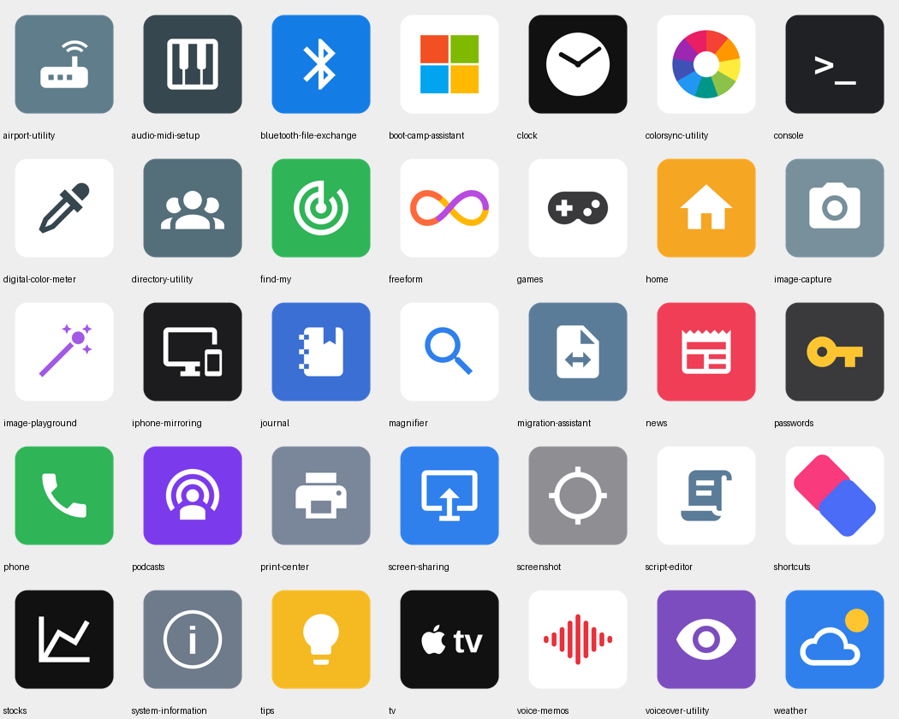

# mac-flat-icons-extra

Flat-design icons for the 35 macOS stock apps that are **missing** from the
[viktorstrate/flat.icns](https://github.com/viktorstrate/flat.icns) set
(Tina Latif's flat icon set), redrawn in the same visual style:
an ~840px rounded-square badge on a 1024px canvas, flat solid colors,
and one bold, simple glyph. No gradients, no shadows.

Together with the original 38 icons from flat.icns, this covers all 69
stock apps listed by Apple for macOS.

## Contents

- `icns/` — ready-to-use `.icns` files (35), named by the app's Japanese name
- `png/` — the 1024×1024 PNG masters
- `tools/build_icons.py` — the script that generated the PNGs
  (Pillow + Iconify glyphs; a few icons — Clock, ColorSync wheel,
  Voice Memos waveform, Shortcuts diamonds, Boot Camp tiles,
  Freeform loop, Weather sun — are drawn programmatically)

## Included apps

Freeform, Journal, Passwords, Image Playground, Phone, Games, Magnifier,
iPhone Mirroring, TV, Podcasts, Weather, Stocks, News, Home, Find My,
Shortcuts, Clock, Voice Memos, AirPort Utility, Audio MIDI Setup,
Bluetooth File Exchange, Boot Camp Assistant, ColorSync Utility, Console,
Digital Color Meter, Directory Utility, Image Capture, Print Center,
Screen Sharing, Screenshot, Script Editor, System Information, Tips,
VoiceOver Utility, Migration Assistant.

## How to apply

Open the app's "Get Info" window and drag the `.icns` file onto the icon
in the top-left corner. To restore the original, select that icon and
press Delete. Apps inside `/System/Applications` may refuse direct
changes; use a tool such as IconChamp for those. macOS updates can
revert stock app icons.

## Credits and license

- Glyphs are mostly silhouettes from
  [Material Design Icons](https://pictogrammers.com/library/mdi/)
  by Pictogrammers, licensed under the Apache License 2.0.
- The icons in this repository were drawn/generated for this project.
  Feel free to use them for personal customization.
- This project is not affiliated with Apple Inc. App names are
  trademarks of their respective owners.
